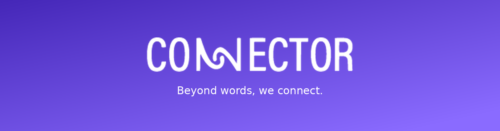
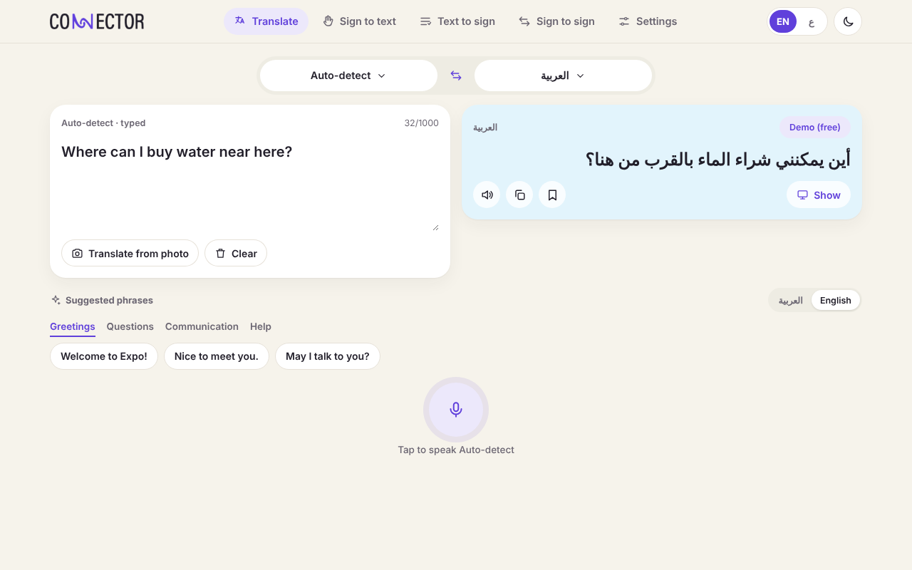
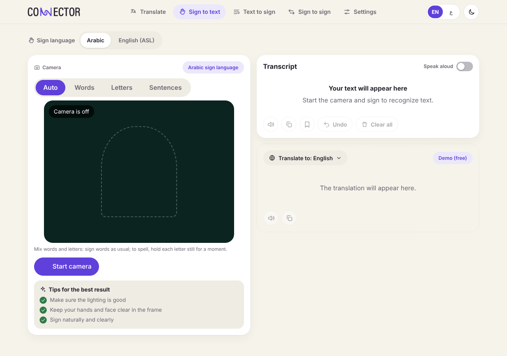
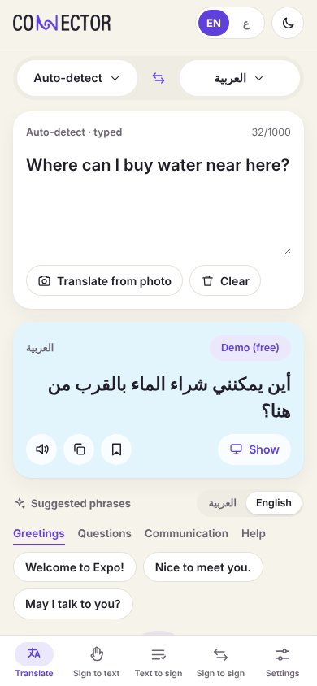

<p align="center"></p>

<p align="center">
  
  
  
  
</p>

# Connector — Communication Without Barriers

**Connector** is a proof-of-concept web app that lets a deaf signer and anyone who speaks any language communicate through text. It combines in-browser sign recognition, text translation, voice, and a signing avatar.

> مشروع تجريبي يربط بين الصم وأي شخص بأي لغة عبر النص: يتعرّف على الإشارة، ويترجم، وينطق، ويعرض الإشارة بشخصية ثلاثية الأبعاد.

Sign languages supported: **Arabic Sign Language** and **American Sign Language (ASL)**. The interface is available in Arabic and English (RTL/LTR) and works on desktop and mobile.

## Screenshots

| Translate | Sign to text & voice |
| --- | --- |
|  |  |

<p align="center"></p>

## Features

| Page | What it does | Status |
| --- | --- | --- |
| **Translate** | Text, voice and photo translation between 27 languages, with auto-detect, copy, and read-aloud. A photo of a sign or menu is read on the device (OCR) and then translated. | Working |
| **Sign to text & voice** | Camera → recognized text → translation into any supported language → read aloud. Arabic: words, letters and sentences. English: ASL fingerspelling (A–Z). | Arabic working; English is letters only |
| **Sign to sign** | An Arabic signer and an English (ASL) signer talk to each other, in both directions: each signs to the camera and the other side sees the message signed in their own language. | Working; English side is fingerspelled letters |
| **Text to sign** | Type or speak in any language (auto-detected). It is translated to Arabic or English, then signed. Arabic: sign player. English: 3D avatar. | Arabic working; English avatar is experimental |
| **Settings** | History and saved phrases (kept on the device), languages, light/dark/system appearance, accessibility (text size, high contrast, captions, vibration), help and about. | Working |

**Limitations (please read):**
- The English avatar uses an English word order with a small ASL vocabulary (about 30 signs) and fingerspells every other word. It is *not* full ASL grammar and should be reviewed by Deaf signers before real use.
- English sign recognition covers fingerspelled letters only, not whole words or sentences.
- The two demo sentences ("Hello, I am a sign language interpreter" and its Arabic version) have a fixed translation so the demo never depends on a free service's wording; every other text goes through the translation services.
- Photo reading (OCR) works best with clear, printed text; English and Arabic work offline, other languages download their data on first use. Document translation is not implemented.
- Voice input uses the browser's Web Speech API, so support depends on the browser (best in Chrome, Edge and Safari). Camera and microphone on phones need HTTPS.

## How it works

```text
Sign → Text:   camera → MediaPipe hand/pose landmarks → ONNX models (in the browser) → text
                                                         → translation → text-to-speech
Text → Sign:   text/voice → language detection → translation to Arabic or English
                                                         → Arabic sign player / 3D signing avatar
Translate:     text/voice → translation (DeepL → Google → MyMemory fallback) → text-to-speech
```

Recognition and photo reading run entirely in the browser; camera frames and photos are not uploaded. Only text is sent to the translation services.

## Tech stack

React 19, Vite, React Router, three.js, MediaPipe Tasks Vision, ONNX Runtime Web, Tesseract.js (photo OCR), [`@three-ws/sign-language`](https://www.npmjs.com/package/@three-ws/sign-language) (Apache-2.0), Web Speech API.

## Run locally

Requirements: Node.js LTS and npm.

```bash
npm install
cp .env.example .env.local   # optional: add translation keys
npm run dev
```

Open `http://localhost:5173`. To test on a phone on the same Wi-Fi: `npm run dev -- --host` and open the Network URL (camera and microphone need HTTPS, so use the deployed site for those).

Other scripts: `npm run build`, `npm run preview`, `npm run lint`.

### Translation services

Without any key, translation falls back to MyMemory. For better quality, set `DEEPL_API_KEY` (used by the dev proxy in `vite.config.js`) and/or `VITE_GOOGLE_TRANSLATE_KEY`. When deploying, DeepL needs a small serverless function in place of the dev proxy, because the key must stay on the server.

## Deploy (Vercel)

1. Push the repo to GitHub, then in Vercel choose **Add New > Project** and import it. The Vite settings are detected automatically (build `npm run build`, output `dist`).
2. In **Settings > Environment Variables** add `DEEPL_API_KEY` (and optionally `VITE_GOOGLE_TRANSLATE_KEY`), then redeploy.
3. Open the HTTPS link on your phone. Camera and microphone only work over HTTPS.

`api/deepl.js` is the serverless function that keeps the DeepL key on the server; `vercel.json` routes `/deepl/v2/translate` to it and sets caching for the large model files. Without a DeepL key the app falls back to the free translators.

## Project structure

```text
src/
├── components/   # App shell (top bar + bottom tab bar), language sheet, camera capture, sign player, 3D avatar
├── i18n/         # Arabic / English interface text
├── pages/        # Translate, Sign to text, Text to sign, Sign to sign, Settings (history, saved, help, about), Welcome
├── state/        # Shared app state: language, appearance, history, saved phrases
├── services/     # Translation, voice, clipboard, suggested phrases
└── sli/          # Arabic sign language engine (recognition + sign planning)
api/               # Serverless DeepL proxy (Vercel)
public/
├── models/       # ONNX recognition models
├── mediapipe/    # MediaPipe landmark models and runtime
├── tessdata/     # OCR language data (English, Arabic)
├── clips/        # Arabic sign clips
└── avatars/      # 3D avatar (GLB)
```

## Credits and licences

This is a hackathon proof of concept. Third-party code, models, clips and avatars keep their own licences; check them before any public or commercial use.

| Component | Used for | Licence |
| --- | --- | --- |
| [three.js](https://threejs.org) | 3D rendering | MIT |
| [`@three-ws/sign-language`](https://www.npmjs.com/package/@three-ws/sign-language) | English signing avatar animation | Apache-2.0 |
| [MediaPipe Tasks](https://github.com/google-ai-edge/mediapipe) | Hand, pose and face landmarks | Apache-2.0 |
| [Tesseract.js](https://github.com/naptha/tesseract.js) and its language data | Reading text from photos | Apache-2.0 |
| [ONNX Runtime Web](https://github.com/microsoft/onnxruntime) | Running models in the browser | MIT |
| [`nocontextdoruk/asl-landmark-mlp`](https://huggingface.co/nocontextdoruk/asl-landmark-mlp) | English fingerspelling classifier (`public/models/asl`) | CC BY-NC 4.0 (non-commercial) |
| [SLI](https://github.com/Digital-Fingers-Team/sli-ai) by the Digital Fingers Team, with [SLI Sentences](https://huggingface.co/DF-Team/sli-sentences) models | Arabic sign recognition engine (`src/sli`), models (`public/models`) and sign clips (`public/clips`). Models were trained on Isharah-1000 and pre-trained on KArSL | Code MIT; model weights CC BY-NC-SA 4.0 (non-commercial, share-alike, credit required) |
| DeepL, Google Cloud Translation, MyMemory | Text translation | Their own terms of service |

## Vision

A world where communication is limited neither by language nor by hearing ability.
